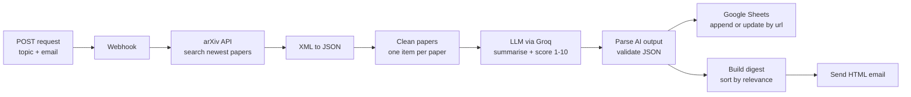

# AI Research Digest

An n8n automation that turns a research topic into a ranked, AI-summarised digest of the newest papers on arXiv. It emails the digest and logs every paper to Google Sheets.

Send one request, for example `{"topic": "climate downscaling"}`, and a few seconds later you get an email with the five newest papers, each with a plain-English summary, the method used, the key finding and a relevance score.

## Process map



## What it does

1. **Webhook** receives a JSON request with a research topic and an email address.
2. **arXiv API** returns the five most recent papers that match every keyword in the topic.
3. **XML node** converts arXiv's Atom feed into JSON.
4. **Clean papers** (JavaScript) splits the feed into one item per paper and tidies titles, authors, dates and abstracts.
5. **Basic LLM Chain** sends each paper to an LLM, which returns a structured JSON summary and a relevance score.
6. **Parse AI output** (JavaScript) validates the AI reply and merges it back with the paper details.
7. **Google Sheets** stores each paper, matching on the paper URL so repeated runs update rows instead of duplicating them.
8. **Build digest** (JavaScript) sorts papers by relevance and builds an HTML email.
9. **Send Email** delivers the digest over SMTP.

## Error handling

- **Rate limits:** the LLM step processes one paper at a time with a 5-second delay, which keeps the workflow inside free-tier limits.
- **Broken AI output:** the parser strips code fences, fixes stray backslashes from LaTeX in abstracts, and falls back to "Not provided" for missing fields, so one bad reply never stops the run.
- **Score validation:** relevance scores are forced to whole numbers from 1 to 10 so sorting always works.
- **Duplicates:** Google Sheets uses Append or Update, matched on the paper URL.
- **Edge cases:** the parser handles searches that return a single paper or a single author, where arXiv returns an object instead of a list.
- **Model portability:** the LLM was switched from Google Gemini to Groq without changing any other node, because parsing does not depend on a specific provider.

## Tech stack

| Layer | Tool |
|---|---|
| Workflow automation | n8n (self-hosted, Community Edition) |
| Data source | arXiv API |
| LLM | Groq (Llama), via n8n Basic LLM Chain |
| Custom logic | JavaScript Code nodes |
| Storage | Google Sheets |
| Delivery | SMTP email (Gmail) |
| Testing | Postman |

## Example request

```bash
curl -X POST http://localhost:5678/webhook/research-request \
  -H "Content-Type: application/json" \
  -d '{"topic": "climate downscaling", "email": "you@example.com"}'
```

Response:

```json
{ "message": "Workflow was started" }
```

## Example AI output for one paper

```json
{
  "title": "Climate downscaling with likelihood functional flow matching",
  "method": "Functional flow matching (CD-FFM)",
  "key_finding": "Lowers CRPS by 27-31% against regression and samples about 50 times faster than a diffusion model",
  "relevance_score": 9,
  "relevance_reason": "Directly addresses climate downscaling with a faster, more accurate generative method."
}
```

## Run it yourself

1. Install n8n: `npm install -g n8n`, then run `n8n start` and open `http://localhost:5678`.
2. Import `workflow/ai-research-digest.json` (Workflows, then Import from file).
3. Add your own credentials:
   - **Groq API key** from console.groq.com
   - **Google Sheets OAuth2** (a Google Cloud OAuth client with the Sheets and Drive APIs enabled)
   - **SMTP** (for Gmail, use an app password)
4. Create a Google Sheet with these headers in row 1:
   `topic | title | authors | published | summary | url | method | key_finding | relevance_score | relevance_reason`
5. Select your sheet in the Google Sheets node, then publish the workflow.
6. Send a POST request to `/webhook/research-request`.

No credentials or API keys are stored in this repository.

## Author

Anita Kanini Mutemi, Nairobi, Kenya
[GitHub](https://github.com/Patmut254)
